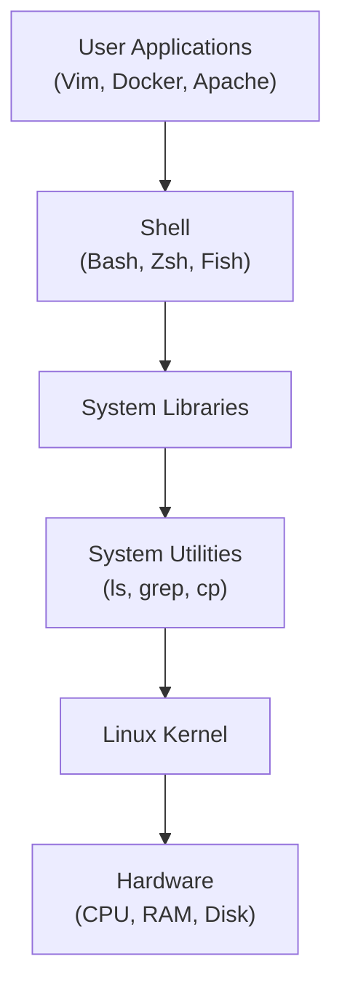

<div align="center">

# Linux Fundamentals

### Setting up a Linux environment on Windows & macOS using Docker


</div>

---

## Table of Contents

1. [Introduction](#1-introduction)
2. [Linux Distributions](#2-linux-distributions)
3. [Linux Operating System Architecture](#3-linux-operating-system-architecture)
4. [References](#references)

---

## 1. Introduction

A Linux environment can be set up on Windows or macOS using:

| Method | Best for |
|---|---|
| **WSL2** | Native-feeling Linux on Windows |
| **VirtualBox** | Full virtual machines |
| **Cloud VMs** | Remote, always-on servers |
| **Docker** | Lightweight, disposable Linux containers |

> [!TIP]
> **Docker Desktop** is a convenient option because it lets you run Linux containers without installing a complete virtual machine.

### Docker Command for Windows (PowerShell)

First, create an `ubuntu-data` folder in your **Downloads** directory and replace `YOUR_USERNAME` with your Windows username.

```powershell
docker run -dit `
  --name ubuntu-container `
  --hostname ubuntu-dev `
  --restart unless-stopped `
  --cpus="2" `
  --memory="4g" `
  --mount type=bind,source="C:/Users/YOUR_USERNAME/Downloads/ubuntu-data",target=/data `
  -p 2222:22 `
  -p 8080:80 `
  --env TZ=Asia/Kolkata `
  ubuntu:latest /bin/bash
```

### Docker Command for macOS / Linux

Create the directory `/tmp/ubuntu-data` before running the command.

```bash
mkdir -p /tmp/ubuntu-data

docker run -dit \
  --name ubuntu-container \
  --hostname ubuntu-dev \
  --restart unless-stopped \
  --cpus="2" \
  --memory="4g" \
  --mount type=bind,source=/tmp/ubuntu-data,target=/data \
  -p 2222:22 \
  -p 8080:80 \
  --env TZ=Asia/Kolkata \
  ubuntu:latest /bin/bash
```

> [!NOTE]
> These commands create a **persistent container**, but the Ubuntu image does **not** automatically configure SSH or a web server. Ports `2222` and `8080` will only work after you install and start those services inside the container.

> [!WARNING]
> Mounting the Docker socket (`/var/run/docker.sock`) into a container is intentionally **omitted** here. It grants significant control over the host's Docker environment and should be avoided unless you really need it.

### Important Parameters

| Parameter | Description |
|---|---|
| `-dit` | Runs the container in detached, interactive terminal mode |
| `--name` | Assigns a name to the container |
| `--hostname` | Sets the hostname inside the container |
| `--restart unless-stopped` | Automatically restarts the container unless manually stopped |
| `--cpus="2"` | Limits CPU usage to two cores |
| `--memory="4g"` | Limits memory usage to 4 GB |
| `--mount` | Shares a host directory with the container to persist data |
| `-p 2222:22` | Maps host port **2222** to container port **22** |
| `-p 8080:80` | Maps host port **8080** to container port **80** |
| `--env TZ=Asia/Kolkata` | Sets the timezone |
| `ubuntu:latest` | Specifies the Ubuntu image |

### Accessing the Container

```bash
docker exec -it ubuntu-container bash
```

---

## 2. Linux Distributions

Linux distributions (**distros**) combine the Linux kernel with system utilities, libraries, and package managers.

| Distribution | Description |
|---|---|
| **Ubuntu** | Beginner-friendly and widely used for servers |
| **Debian** | Stable and reliable |
| **Fedora** | Offers newer technologies |
| **Rocky Linux / AlmaLinux** | Enterprise-oriented alternatives to CentOS Linux |
| **Arch Linux** | Highly customizable |
| **Kali Linux** | Designed for cybersecurity and penetration testing |
| **Alpine Linux** | Lightweight and commonly used in containers |

---

## 3. Linux Operating System Architecture

Linux is built in layers, from the hardware at the bottom to the applications you use at the top.



<details>
<summary>Plain-text version</summary>

```text
+----------------------------------+
| User Applications (Vim, Docker)  |
+----------------------------------+
| Shell (Bash, Zsh, Fish)          |
+----------------------------------+
| System Libraries                 |
+----------------------------------+
| System Utilities (ls, grep)      |
+----------------------------------+
| Linux Kernel                     |
+----------------------------------+
| Hardware (CPU, RAM, Disk)        |
+----------------------------------+
```

</details>

### Layer Breakdown

| Layer | Role |
|---|---|
| **Hardware** | Physical components such as the CPU, RAM, and storage |
| **Kernel** | The core of Linux; manages processes, memory, devices, file systems, and networking |
| **System Utilities** | Tools such as `ls`, `grep`, and `cp` used to manage the system |
| **System Libraries** | Provide functions that applications use to interact with the operating system |
| **Shell** | A command interpreter, such as Bash or Zsh, that accepts user commands and launches programs |
| **User Applications** | Programs such as Vim, Docker, and Apache that perform specific tasks |

---

## References

- [Linux Kernel Repository](https://git.kernel.org/)
- [Linux Kernel on GitHub](https://github.com/torvalds/linux)

---

<div align="center">

If you found these notes helpful, consider starring the repo.

</div>